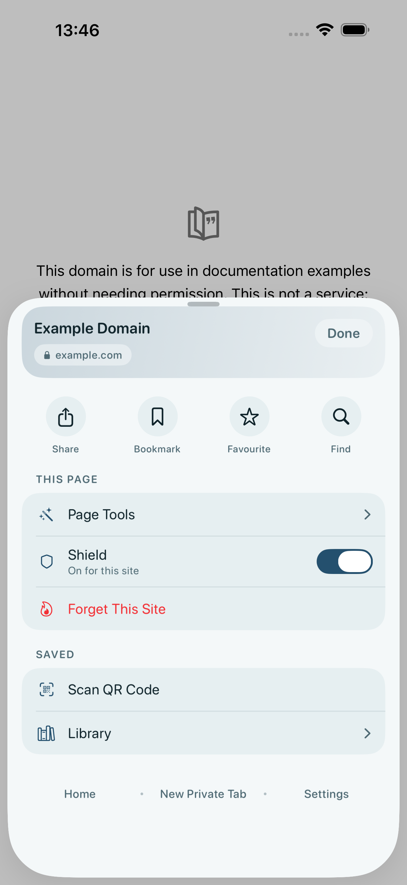
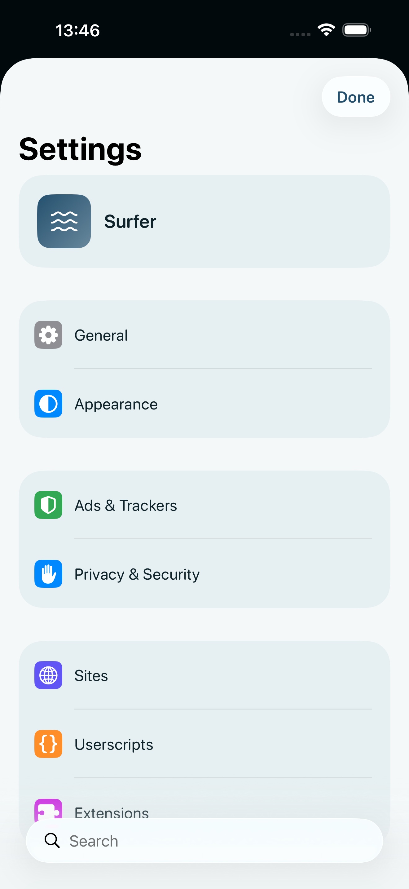
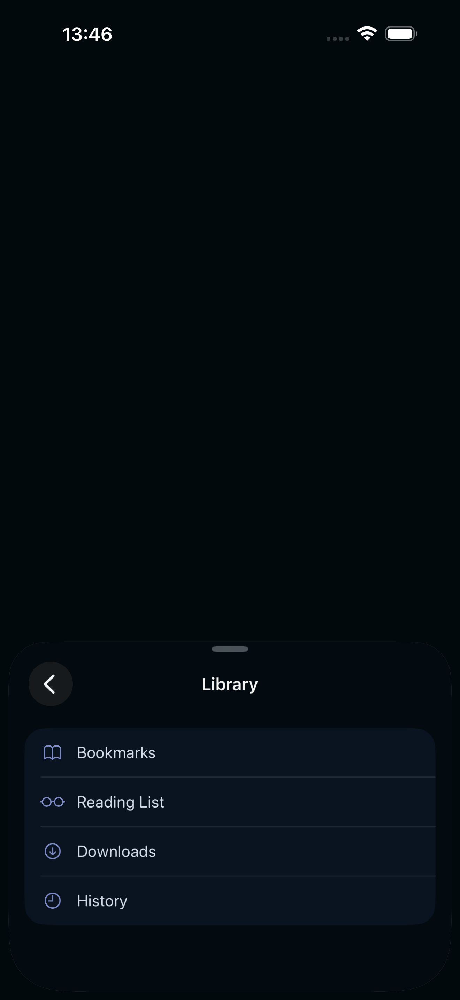

# Surfer

A calm, minimal web browser for iPhone and iPad, with a shield built in.

Surfer blocks ads and trackers, stops pop-ups and tap-ad redirects, and keeps your private tabs out of the app switcher. It has no accounts and no analytics, shows you what it blocks, and lets you turn off every protection.

## Get it

**TestFlight beta:** _link coming soon_

Install [TestFlight](https://apps.apple.com/app/testflight/id899247664) from the App Store, then open the link above on your iPhone or iPad. Surfer needs iOS 17 or later.

## Screenshots

| The menu | Settings | Library |
|---|---|---|
|  |  |  |

## Features

**Shield**
- Ad and tracker blocking with uBlock-class filter lists, built on your device
- Pop-up and tap-ad redirect protection
- Cookie banners hidden
- Links upgraded to https, and tracking parameters removed from links
- Block any element on a page by tapping it
- Shows what it blocked on each page

**Browsing**
- Private tabs that are never saved and stay out of the app switcher
- Tab groups
- Reader mode and pages saved for offline reading
- Dark pages
- A QR scanner
- Downloads, with press and hold on a link
- Page summaries written by the language model built into your iPhone
- Translate Page
- Userscripts

**Your sites, your rules**
- Camera, microphone, location and JavaScript set to Allow, Ask or Block for each site

**Across your devices**
- Widgets
- An "Open in Surfer" share extension
- Bookmarks, reading list and site settings synced over iCloud, if you turn it on
- Handoff for the page you're viewing (never a private tab)

## Private by design

- No accounts.
- No analytics, no advertising, no tracking.
- No server of mine that Surfer talks to.
- History, bookmarks and settings stay on your device.

Read the full [privacy policy](privacy-policy.md).

## Feedback

Found a bug or have an idea? [Open an issue](https://github.com/abhivirchaudhary/Surfer/issues).

---

Made by [Abhivir Chaudhary](https://abhivir.xyz). Surfer's source code is not public.
